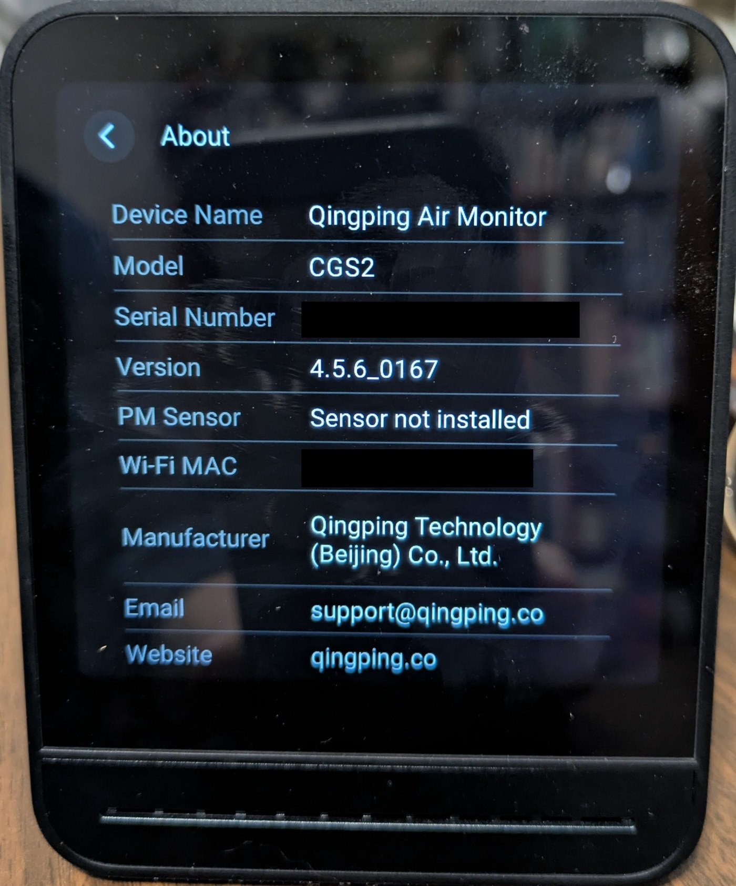
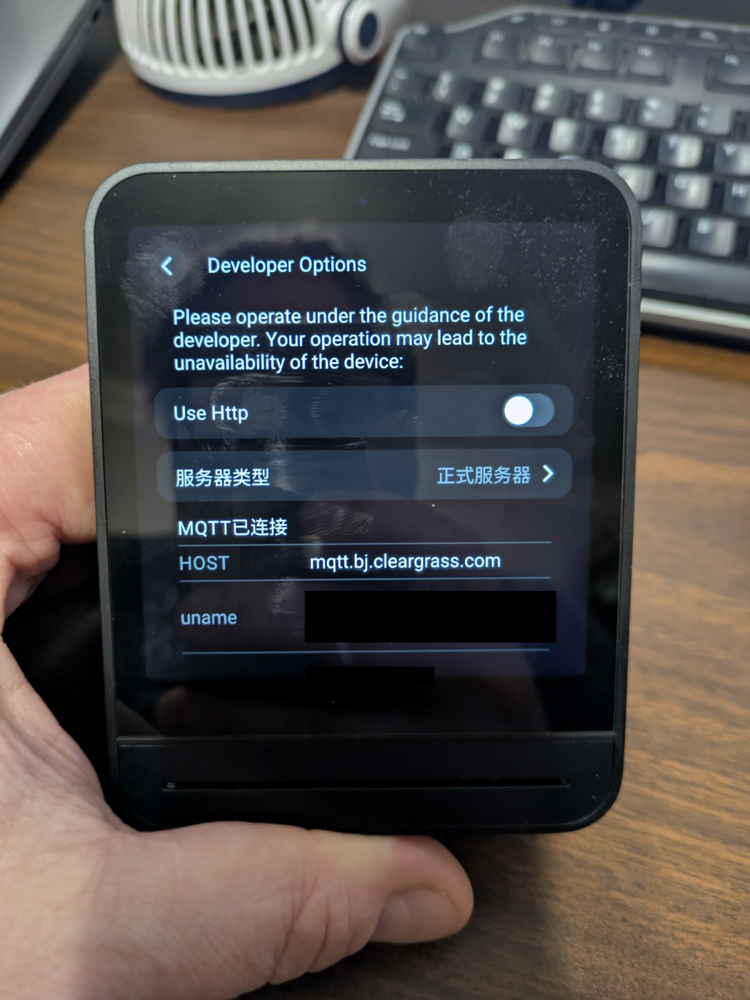
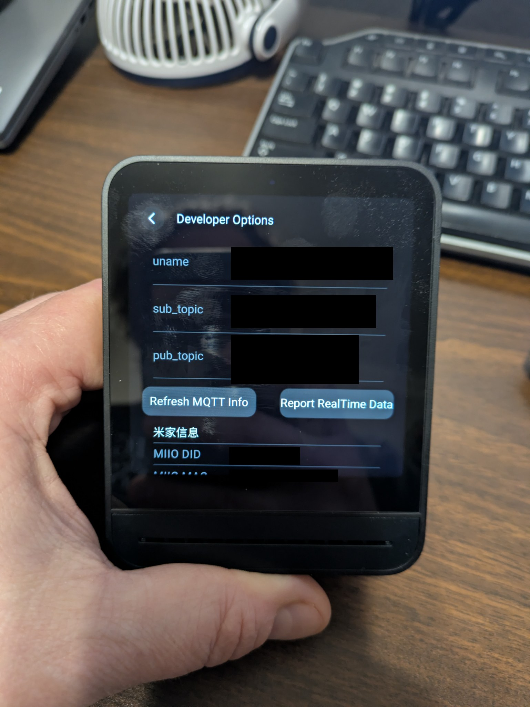
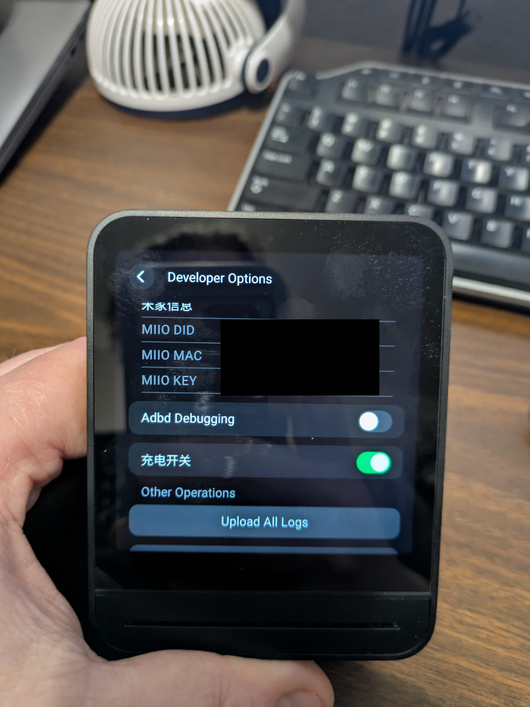
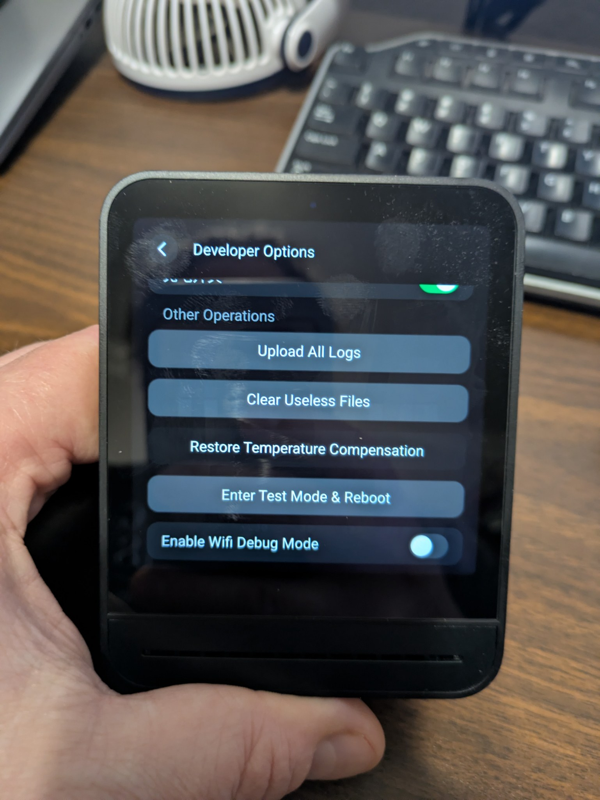

# 00. Getting a shell on the device

Every other guide assumes you can run commands on the device as root.

## What you need

- A PC on the same network as the device, with `adb` installed (Android platform-tools; it works with this non-Android Linux device).
- The device's IP address (give it a fixed lease in your router).

## Enable debugging on the device

The method comes from the original article (in German).

1. **Open the About screen and tap the Device Name row (the first line) seven times.** A **Developer Options** screen appears. It opens with a warning that operating under the guidance of the developer is advised and that your actions may make the device unavailable. Take that seriously.
2. Turn on **Adbd Debugging**. It sits in the middle of the screen, below the Mi Home information. It appears to correspond to `is_adbd_enabled` in the `[developer]` section of `setting.ini`.
3. Scroll to the bottom and turn on **Enable Wifi Debug Mode**.

We turned on both switches. We did not test whether either one alone is enough, or whether a reboot is needed.

The About screen looks like this (serial number and Wi-Fi MAC blacked out). It also shows the model, the firmware version, and whether a PM sensor is installed:



**The Developer Options screen shows secrets.** It displays the Mi Home identifiers and key, and the MQTT user name and topics (which contain the device's MAC address and the product key). Do not post photos or screenshots of it without blacking those lines out. The photos below have been redacted with solid black boxes and re-saved without metadata.

### The screen, top to bottom









## What else is on the Developer Options screen

Some labels are in Chinese; the translations below are ours, not vendor documentation. We only toggled the two switches above and did not press anything else, so the "probably" entries are guesses from the labels.

| Item | What it probably is | Notes |
|---|---|---|
| Use Http (switch) | Unknown | Off on our unit; left alone |
| 服务器类型 ("server type"), set to 正式服务器 ("official / production server") | Chooses which cloud environment the device talks to | Not touched |
| MQTT已连接 ("MQTT connected"), HOST, uname, sub_topic, pub_topic | Live MQTT connection status | Handy for checking which broker the device is using. We have not checked what it shows after the host change |
| Refresh MQTT Info | Possibly re-fetches the MQTT connection details | **Not pressed.** If it asks the vendor cloud for new details it could overwrite your host. If you press it, check the host afterwards |
| Report RealTime Data | Possibly makes the device publish a reading immediately | Not tried |
| 米家信息 ("Mi Home information"): MIIO DID, MAC, KEY | Identifiers and a key for the vendor's integration | **Secret** |
| 充电开关 ("charging switch") | Probably turns battery charging on and off | On for us. If the battery drains while the device is plugged in, check this |
| Upload All Logs | Probably sends the device's logs to the vendor | Not pressed; we have not verified where they go |
| Clear Useless Files | Probably clears `/userdata/etc/debug/` | A guess based on `rm -r` commands for that folder inside the app. It would delete the debug files [guide 02](02-light-sensor.md) is about |
| Restore Temperature Compensation | Resets the temperature offset | Not pressed |
| Enter Test Mode & Reboot | A factory test mode | Not pressed; avoid it |

## Connect

```
adb connect DEVICE_IP:5555
adb -s DEVICE_IP:5555 shell
```

You should get a root prompt like `[root@Qingping-Air-Monitor:/]#`. In our tests there was no password or pairing step; see [security.md](security.md).

## Back up before changing anything

`/data` is a symlink to `/userdata`, so both paths mean the same thing.

```
cp /userdata/etc/setting.ini /userdata/etc/setting.ini.original
```

Also copy it to your PC, **outside this repository** (it contains secrets):

```
adb -s DEVICE_IP:5555 pull /userdata/etc/setting.ini private/setting.ini.original
```

## Terminal tips

- Long pasted lines wrap and get mangled in an adb shell. Prefer pushing script files with `adb push`, or paste short commands.
- If you create a file on the device with `cat > file << 'EOF'`, check it afterwards with `sh -n file` (syntax) and `cat file`.
- In Windows PowerShell, `>` redirection can corrupt binary data. Use `adb pull` for files.
- To run something on the device from PowerShell without opening a shell: `adb -s DEVICE_IP:5555 shell "command here"`.

## Undoing your changes

- Restore the original settings (stop the watchdog and app first; see [01](01-local-mqtt.md)), then reboot.
- Remove any boot hooks you added: `rm /etc/init.d/S90pub` ([02](02-light-sensor.md)) and/or `rm /etc/init.d/S91squeezelite` ([03](03-music-assistant.md)), whichever you installed.
- A normal `reboot` is the safest way to restart; `reboot -f` is abrupt (it worked for us, but it skips a clean shutdown).
- To close the door again, turn the two switches off. We have not tested how that interacts with our boot hooks.
