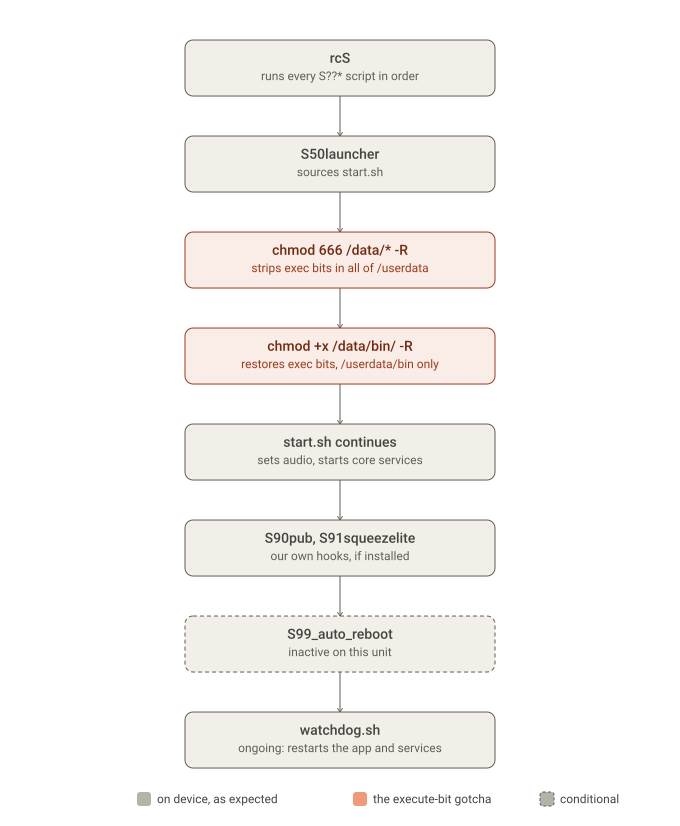

# How the device works (observations from one unit)

Everything here is what we saw on one CGS2 with firmware 4.5.6_0167. It is not vendor documentation, and other units may differ.

## The platform

| | |
|---|---|
| Kernel | Linux 4.19.232, aarch64 (not Android) |
| Userland | Buildroot 2018.02-rc3 base with glibc 2.29, libstdc++ 6.0.28, Qt 5.14.2, busybox |
| Vendor firmware string | `CLEARGRASS_VERSION=4.5.6_0167` in `/qingping/etc/os-release` |
| Present | `curl` 7.75.0 (with MQTT), `sox`, `aplay`, `arecord`, `gst-launch-1.0`, `bash`, `awk` |
| Absent | package manager, a Python interpreter (the libpython libraries are there, nothing runs on them), `nc`, `mosquitto_pub` |

The 7-tap developer mode and `adb` make it feel like Android, but `adbd` runs fine on plain Linux, and there is no `getprop`.

## What runs

- `QingSnow2App -platform eglfs`: the main Qt app (screen, sensors, MQTT, settings).
- `watchdog.sh`: restarts the app and some services (see below).
- `analyze_noise.sh`: the noise sensor, using the microphone.
- `miio_client` and helpers: Xiaomi's miio cloud client, separate from the
  Qingping/Cleargrass side of the app (see "The cloud" below and
  [security.md](security.md)).
- `adbd` (the debugging port), `dnsmasq`, `ntpd`, `dhcpcd`, `wpa_supplicant`, `input-event-daemon`, `dbus-daemon`.

## Boot sequence

`/etc/init.d/rcS` runs every `S??*` script in order (files ending in `.sh` are sourced; the rest run as `script start`). The important ones:

- `S50launcher` sources `/qingping/bin/start.sh`, which:
  - runs `chmod 666 /data/* -R`, **stripping execute bits** from everything in `/userdata` (`/data` is a symlink to `/userdata`);
  - copies `/qingping/data/*` into `/data/`;
  - runs `chmod +x /data/bin/ -R`, so **`/userdata/bin` regains its execute bits**;
  - powers the sensors, sets the speaker and microphone paths with `amixer`, starts `wpa_supplicant`, starts `watchdog.sh`, and starts the cloud client.
- `S51n4` starts `/usr/bin/n4` if it exists (we do not know what it does).
- `S99_auto_reboot` only acts if Rockchip factory-test files exist, and they did not on our unit.

Our own hooks, `S90pub` and `S91squeezelite`, run after the launcher.

The strip-then-restore step is the gotcha that cost us the most time: a
script copied into `/userdata` loses its execute bit at every boot, and
only the `/userdata/bin` subfolder gets it back. That is why every script
in this repository is either started with `sh script` or kept in
`/userdata/bin`, never run directly from elsewhere in `/userdata`.

## `watchdog.sh`

- Restarts the app within about 5 seconds if it dies.
- Kills the app if free memory drops below 45 MB. In practice the app slowly leaks memory, so this happens every day or so; see [known-issue-memory-leak.md](known-issue-memory-leak.md).
- Runs `reboot -f` if the app has been restarted more than four times with less than 60 seconds between restarts (so a crash loop reboots the device).
- Restarts `dhcpcd`, `wpa_supplicant`, the cloud client and `analyze_noise.sh` if they die.

## `setting.ini`

`/userdata/etc/setting.ini` looks like a Qt settings file (sections sorted alphabetically, quoted values where needed). The app keeps these values in memory and rewrites the file regularly, which is why edits made while it runs are lost. The `[host]` section holds the MQTT connection. `[developer]` holds `is_adbd_enabled`. `[device]` and `[host]` contain secrets.

## `device.conf` and `vendor_storage`

`/qingping/etc/miio/device.conf` holds the Mi Home identity fields: `did`,
`mac`, `key`, `vendor`, `model`. `vendor_storage` is a separate, lower-level
storage area the SoC vendor provides for factory-programmed values; it also
holds the device serial number and the Wi-Fi MAC, which we confirmed by
running `vendor_storage -R`.

The relationship between the two runs in both directions, and they are not
the same direction:

- **At the factory**, a provisioning tool we found on the device,
  `QingFleet.sh`, writes each `device.conf` field one at a time (test
  commands `F212` through `F219`), then copies the finished file into
  `vendor_storage` as a backup (`F215`,
  `sync_miio_config_to_vendor_storage`). `device.conf` is written first;
  `vendor_storage` is the copy.
- **At every boot**, `start.sh`'s `check_miio_config` function does the
  reverse: if `device.conf` is missing or has fewer than five fields, it
  rebuilds `device.conf` by reading the backup out of `vendor_storage`.
  This is a recovery path, not the normal case, since on a working device
  `device.conf` is already complete and this code never runs.

The data-flow diagram in [security.md](security.md) shows the recovery
direction (`vendor_storage` to `device.conf`), because that is what
actually runs at boot on an already-provisioned device like the ones this
repository covers. The factory direction is the reverse of what the
diagram shows.

`QingFleet.sh` also resolves a file we were earlier unsure about:
`/data/etc/debug/test_mode`. Command `FF05` writes `audio` into it to put
the firmware into an audio test mode, and `F511` writes `screen`. Commented
out code in the same block references a `screen_colors` value too, so a
color-test mode may exist but is not currently wired up in this build. We
have not tried any of this and do not recommend it.

**Caution:** unlike everything else in this repository, `QingFleet.sh` is
not read-only. Several of its commands write to `vendor_storage` (the
serial number, the Wi-Fi MAC, the miio identity fields) or force an
immediate reboot. We did not run any of them and would not recommend doing
so on a device already in service: overwriting the identity fields that
MQTT and the Xiaomi GSLB lookup depend on has no obvious way back.

## Sensors and the debug files

The app exposes current readings as small files in `/userdata/etc/debug/`, rewritten about every 4 seconds. The sensors sit on I2C buses: CO2 at `1-0062` (named `scd40` in the driver), PM at `3-0012`, light at `1-0045` (OPT3004). The noise level is also written to `/data/etc/tmp/noise_level` (the vendor-calibrated value) and `raw_noise_level`.

## The cloud

There are two separate vendor cloud relationships here, not one.

- **Qingping/Cleargrass.** The `QingSnow2App` binary contains the hostnames
  `mqtt.bj.cleargrass.com`, `gateway.cleargrass.com`, `hydra.cleargrass.com`,
  `qing.cleargrass.com` and `qing.dev.cleargrass.com`. We never paired the
  device with the vendor app, and its `[qingping]` section says
  `is_paired=false`. We found these hostnames but did not trace what each one
  is used for, and we left this client running.
- **Xiaomi.** `miio_client` is a separate Mi Home/miio cloud client (see
  "What runs" above) that talks to Xiaomi's own infrastructure, unrelated to
  the Qingping/Cleargrass hostnames above. We investigated this one in
  detail with a packet capture: a plaintext lookup to `dns.io.mi.com`, a
  TLS-PSK session to one of three returned addresses, and the device ID
  visible in the clear at two points. Full write-up, with a diagram, in
  [security.md](security.md).

## MQTT message types

On the device's publish topic: `12` is a live reading, `17` a history dump, `40` and `32` alarm and scene syncs. See [01](01-local-mqtt.md).
